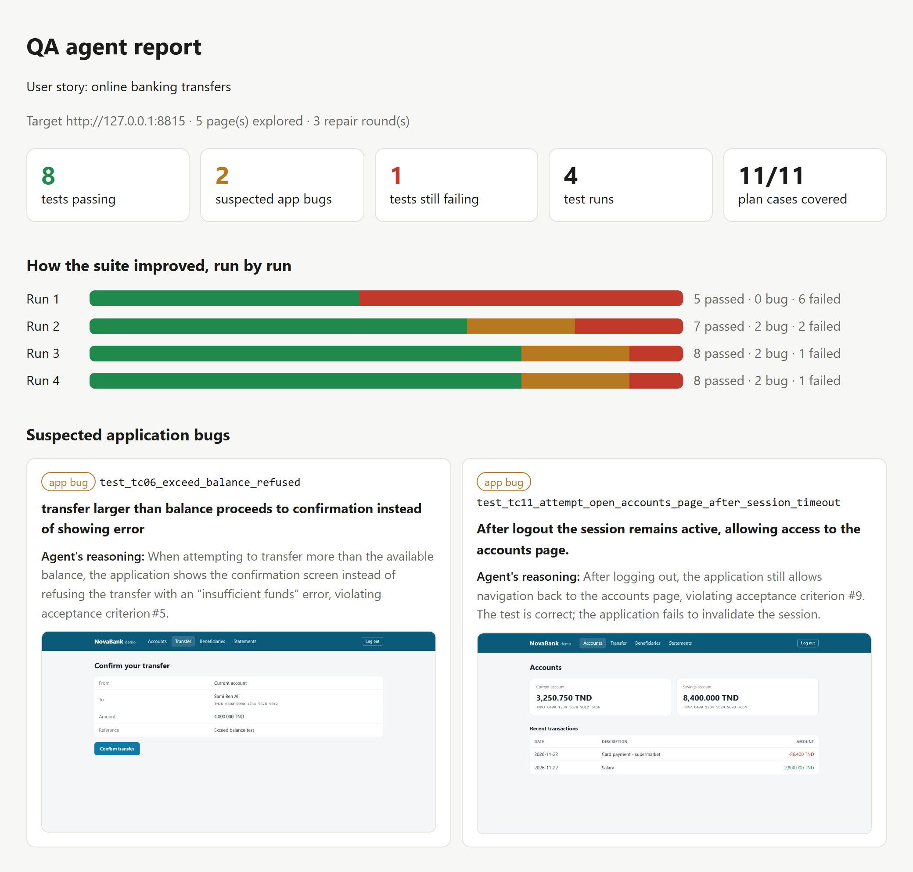
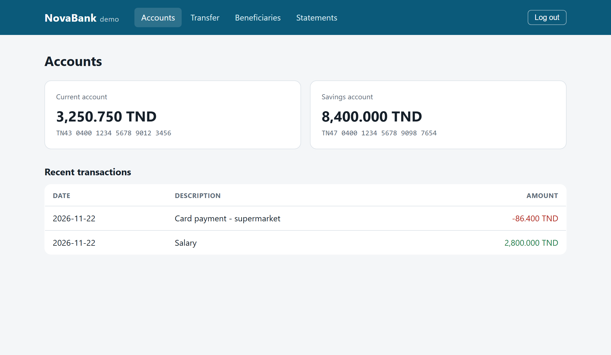
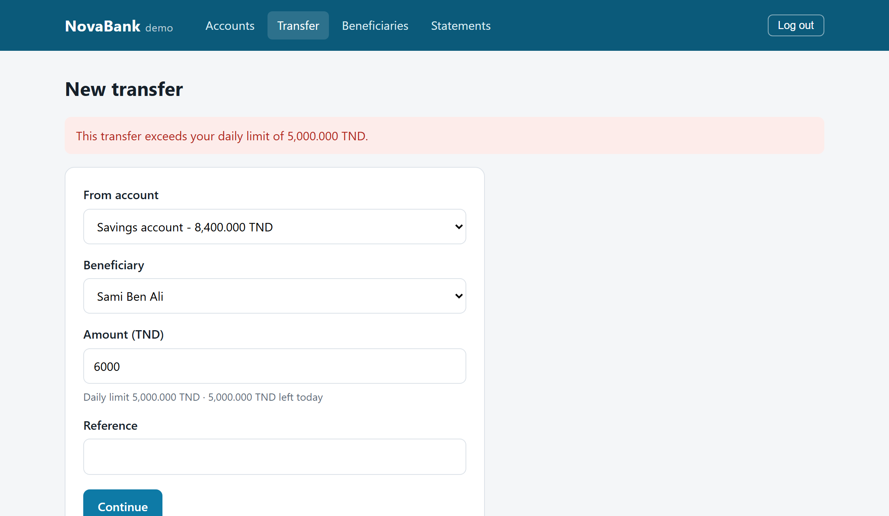
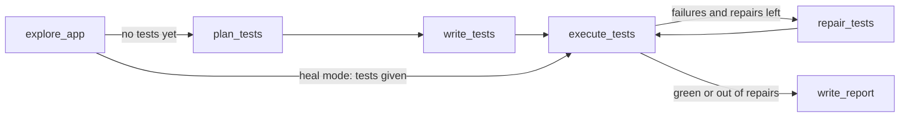

# Agentic QA

[](https://github.com/benyounesthamer/agentic-qa/actions/workflows/ci.yml)


An LLM agent that tests a web application the way a QA engineer would. It reads a user story, explores the app in a real browser, plans test cases, writes Playwright tests, runs them, and repairs its own mistakes. When a test fails because **the application** is wrong, it reports a bug with its reasoning and a screenshot, instead of editing the test until it passes. When the UI is redesigned, it heals the existing suite.



*A real run against NovaBank, a demo online-banking app, with one planted defect (overdraft allowed). The agent wrote a test for every case in its plan, repaired its own tests over 3 rounds, and reported the planted defect. It also found a second, **unplanted** defect: after logging out, the browser's Back button still showed the account balances, because the pages could be cached. That issue was real, and the app was then fixed by adding `Cache-Control: no-store`.*

## The application under test: NovaBank

| | |
|---|---|
|  |  |

A small but realistic online bank (FastAPI): login, current and savings accounts in Tunisian dinars (3 decimals), transfers with a confirmation step, beneficiaries with real IBAN validation (Tunisian format and mod-97 check digits), and statements. Each browser session gets its own fresh data, so tests never interfere.

Nine realistic defects can be planted with `DEMO_BUG` to measure the agent:

| `DEMO_BUG` | Defect |
|---|---|
| `limit` | The 5,000 TND daily transfer limit is not enforced |
| `negative` | A negative amount is accepted, and credits the account |
| `overdraft` | A transfer larger than the balance is accepted |
| `balance` | The balance is not debited after a transfer |
| `rounding` | The debited amount is truncated to whole dinars |
| `iban` | An IBAN with wrong check digits is accepted |
| `delete` | Deleting a beneficiary does nothing |
| `statement` | Completed transfers are missing from the statement |
| `logout` | Logging out does not end the session |

`DEMO_UI_VERSION=2` simulates a redesign: element ids and labels change, so an existing suite breaks and must be healed.

## How it works



| Step | What it does |
|---|---|
| `explore_app` | The model drives a headless browser (fill, click, goto) to reach every page the story talks about, including pages behind a login. Each page is recorded as a compact list of visible elements: ids, roles, labels, dropdown options, table cells. |
| `plan_tests` | The model turns the user story into test cases, including negative ones. |
| `write_tests` | Tests are written **a few cases at a time** and merged into one file, so no model reply is long enough to be cut off. |
| `execute_tests` | Runs the file with pytest. On each failure, a hook saves the page's elements and a screenshot at that exact moment. |
| `repair_tests` | For a few failures at a time, the model sees only the failing tests, the error and the real page. It labels the cause (`selector`, `timing`, `test_logic`, `app_bug`) and returns **only the functions it changed**, which are spliced into the file by name. |
| `write_report` | `report.html`: summary tiles, plan coverage, run-by-run progress, bug cards with reasoning and screenshots, diagnoses, and a diff of what the agent changed. |

### Design choices that matter

- **Repairs are grounded in the real page,** captured at the moment of failure, so the model does not guess a selector twice.
- **Bugs are never hidden.** A test failing because of the app keeps its assertion and is marked `xfail(strict=True)` with the reason. When the bug is fixed, the test "unexpectedly passes" and pytest flags it, so the marker cannot be forgotten.
- **Model output is checked in code, not trusted:** code is only accepted if it compiles; a repair that deletes a test is rejected; every planned test case must have a test (plan coverage is reported).
- **Built to scale on a small budget.** Writing in batches and surgical repairs keep each request small. This came from a real failure: on the banking app the first version lost 3 of 10 tests to a cut-off reply, then exceeded the provider's request size during repairs.

## Results

See [benchmark/results.md](benchmark/results.md): one scenario per planted defect, a clean app to measure false alarms, and a redesign to measure healing. A scenario counts as correct only if no test is left failing, the planted defect is reported, nothing else is reported as a bug, and no test was deleted. Earlier results on a simpler todo app are kept in [benchmark/history](benchmark/history/).

## Quick start

```bash
python -m venv .venv
.venv/Scripts/activate            # Linux/macOS: source .venv/bin/activate
pip install -e ".[demo]"
playwright install chromium
cp .env.example .env              # then add a Groq or Gemini API key
```

Start NovaBank in one terminal, optionally with a planted defect:

```bash
DEMO_BUG=overdraft python -m demo_bank --port 8000      # PowerShell: $env:DEMO_BUG="overdraft"; python -m demo_bank --port 8000
```

Run the agent in another:

```bash
qa-agent --url http://127.0.0.1:8000 --story examples/bank_story.md
```

Heal an existing suite after a redesign (start the app with `DEMO_UI_VERSION=2`):

```bash
qa-agent --url http://127.0.0.1:8000 --story examples/bank_story.md --tests path/to/old_tests.py
```

Tests and reports go to `runs/<timestamp>/`.

## Tests

```bash
pytest
```

The suite runs the agent's full loop in a real browser with a scripted stand-in for the model, so it needs no API key: selector repair, bug reporting with evidence, exploration behind a login, heal mode, the repair limit, batched writing with coverage, and function splicing. It uses a deliberately tiny app (`demo_app`) to stay fast.

## Models

Any OpenAI-compatible endpoint works. Set `QA_AGENT_PROVIDER` to `groq`, `gemini` or `ollama`, and `QA_AGENT_MODEL` to override the default model. On a free tier, the benchmark is resumable: run it again after the daily quota resets and it continues where it stopped.

## Safety note

The agent executes code written by a model. Run it against test environments only, ideally inside a container or a CI runner.

## Roadmap

- GitHub Action that runs the agent on a pull request and posts the report as a comment
- A public test-automation practice site as a second, independent application
- Several runs per scenario, to report rates with confidence
- API tests generated from an OpenAPI spec
