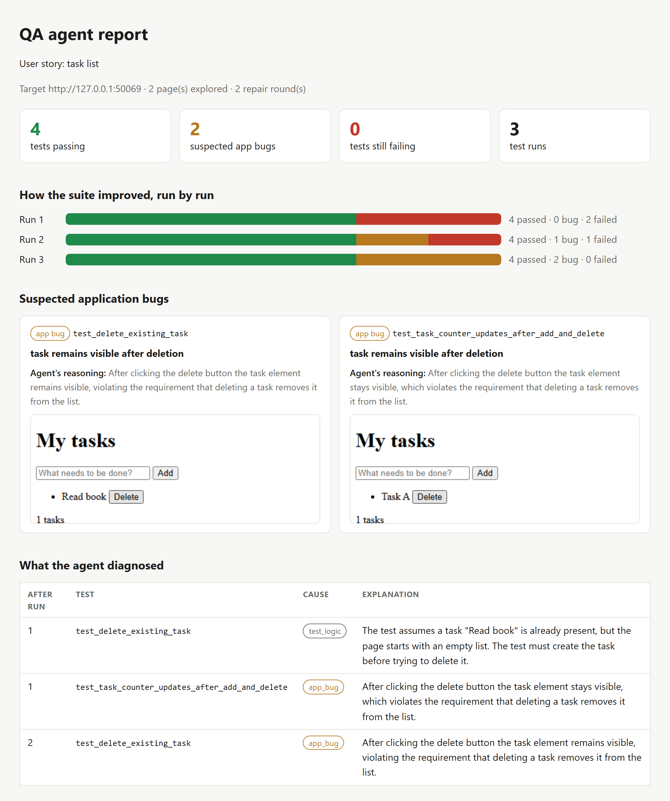
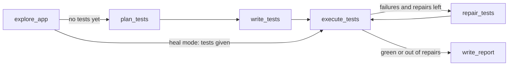

# Agentic QA

[](https://github.com/benyounesthamer/agentic-qa/actions/workflows/ci.yml)


An LLM agent that explores a web app, writes Playwright tests from a user story, runs them in a real browser, and repairs the ones that fail. When a failure is the application's fault, it reports a bug with a screenshot instead of editing the test until it passes. When the UI is redesigned, it heals the existing suite.



*A report from a real benchmark run against the demo app with a planted defect (Delete does nothing). The agent fixed its own test logic, then reported the defect with its reasoning and a screenshot as evidence.*

## How it works



| Step | What it does |
|---|---|
| `explore_app` | The model drives a headless browser (fill, click, goto) to reach the pages the story talks about, including pages behind a login. Every page is recorded as a list of visible elements. |
| `plan_tests` | The model turns the user story into test cases, including negative ones. |
| `write_tests` | The model writes one pytest-playwright file from the plan and the page descriptions. |
| `execute_tests` | Runs the file with pytest. On each failure, a hook saves the page's elements and a screenshot. |
| `repair_tests` | The model sees the error and the real page, labels the cause (`selector`, `timing`, `test_logic`, `app_bug`) and rewrites the file. |
| `write_report` | Writes `report.html` (run-by-run progress, bug cards with screenshots, diagnoses, code diff) and `report.md`. |

Three design choices matter most:

- **Repairs are grounded in the real page.** The failing page's elements are captured at the moment of failure and put in the repair prompt, so the model does not guess a selector twice.
- **Bugs are not hidden.** A test that fails because the app is wrong is marked `xfail(strict=True)` with the reason and shows up in the report as a suspected bug, with a screenshot as evidence.
- **It is measured.** A benchmark plants defects and a UI redesign, and checks that the agent reports the defects, heals the redesign, and raises no false alarm on a clean app.

## Quick start

```bash
python -m venv .venv
.venv/Scripts/activate            # Linux/macOS: source .venv/bin/activate
pip install -e ".[demo]"
playwright install chromium
cp .env.example .env              # then add a Groq or Gemini API key
```

Start the demo app in one terminal:

```bash
python -m demo_app --port 8000
```

Write and repair tests from a story:

```bash
qa-agent --url http://127.0.0.1:8000 --story examples/story.md
```

Heal an existing suite after a UI change:

```bash
qa-agent --url http://127.0.0.1:8000 --story examples/story.md --tests path/to/old_tests.py
```

The tests and reports are written to `runs/<timestamp>/`.

## The demo app

`demo_app` is a small login + task list app with switches for exercising the agent:

| Environment variable | Effect |
|---|---|
| `DEMO_UI_VERSION=2` | A redesign: element ids and button labels change, so existing tests break. |
| `DEMO_BUG=counter` | The task counter does not go down when a task is deleted. |
| `DEMO_BUG=empty` | An empty task can be added. |
| `DEMO_BUG=login` | A wrong password is accepted. |
| `DEMO_BUG=delete` | The Delete button does not remove the task. |

## Results

Benchmark with `openai/gpt-oss-120b` on Groq, one run per scenario, strict scoring: a scenario counts only if no test is left failing, the planted bug is the one reported, nothing else is reported as a bug, and no test was deleted.

| Scenario | Expected | Outcome | Correct |
|---|---|---|---|
| Clean app | All green, no bug reported | 5 passed, no false alarm | yes |
| Counter not updated on delete | Report it | Reported | yes |
| Empty task accepted | Report it | 1 test left failing, not reported | no |
| Wrong password accepted | Report it | Reported | yes |
| Delete does nothing | Report it | Reported | yes |
| UI redesign (heal mode) | Old tests back to green | 5 passed after 2 repairs | yes |
| Redesign + counter bug (heal mode) | Heal and report | Not completed (provider daily quota) | — |

**5 of 6 completed scenarios correct.** Details, and the three earlier runs that shaped the current design, are in [benchmark/results.md](benchmark/results.md).

Limitations, stated plainly:

- One run per scenario, and results vary between runs: the counter bug was missed in two earlier runs, the empty-task bug in this one.
- The prompts were improved on these same scenarios, so the scores are optimistic. A second, unseen application is the next step.
- Two failures found by the benchmark led to code guards rather than prompt changes: model output is only accepted if it compiles, and a repair that deletes a test is rejected.

## Tests

```bash
pytest
```

The suite runs the full loop against the demo app in a real browser, with a scripted stand-in for the model, so it needs no API key. It covers selector repair, bug reporting with evidence, exploration behind the login, heal mode after a redesign, and the repair limit.

## Models

Any OpenAI-compatible endpoint works. Set `QA_AGENT_PROVIDER` to `groq`, `gemini` or `ollama`, and `QA_AGENT_MODEL` to override the default model.

## Safety note

The agent executes code written by a model. Run it against test environments only, ideally inside a container or a CI runner.

## Roadmap

- API tests generated from an OpenAPI spec
- GitHub Action that runs the agent on a pull request and posts the report
- Larger benchmark: several runs per scenario and a second application
